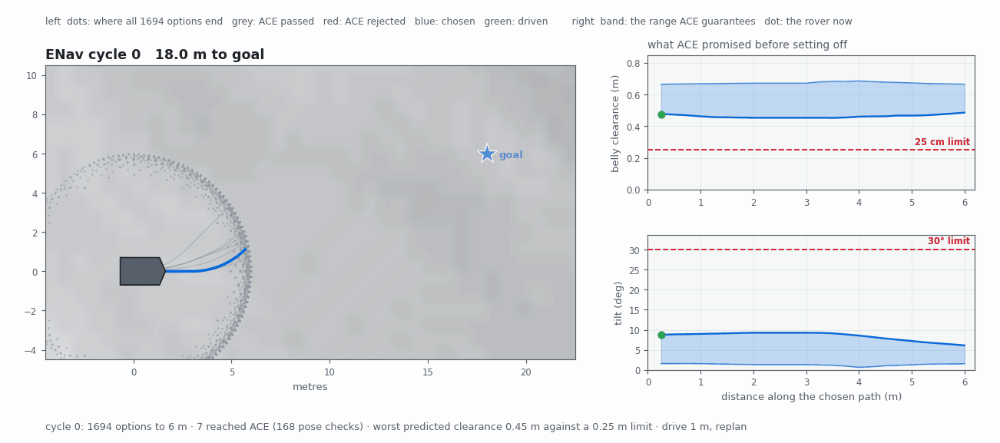

# ACE and ENav

The two algorithms Perseverance navigates with, implemented from the
published papers. Pure kinematics — this folder imports numpy and nothing
else.

| | |
|---|---|
| [`core.py`](core.py) | **ACE** — predicts what the suspension will do, without simulating it |
| [`enav.py`](enav.py) | **ENav** — the planner that spends it |

---

<p align="center">
  <picture>
    <source media="(prefers-color-scheme: dark)" srcset="../images/anim_enav_explainer_dark.gif">
    
  </picture>
</p>

*One cycle of the loop. **Left:** the ring is where all 1,694 options end,
grey passed ACE, red was rejected, blue won, green is where the rover has
been. **Right:** what ACE promised before setting off, against the limits
that decide whether the path is allowed at all.*

## Why it is hard

A car has a fixed shape. Perseverance does not — six wheels on a folding
rocker-bogie, so its **tilt and belly height are consequences of wherever the
wheels come to rest**, not properties of the rover.

So "will my belly clear that rock?" can't be answered by looking at the rock.
It depends on all six wheel positions at once, known only from a photograph,
to within a few centimetres.

## What ACE returns

A **guaranteed range**, not a number:

```python
from ace import ace

b = ace({"LF": (0.00, 0.05), "LM": (0.01, 0.04), "LR": (0.00, 0.03),
         "RF": (0.02, 0.06), "RM": (0.00, 0.05), "RR": (0.01, 0.04)})

b.clearance      # [0.45, 0.67] m
b.tilt           # [0.02, 0.16] rad
b.safe()         # True, against the published limits
```

The truth must land **inside** that range. If ACE is wrong it has to be wrong
*pessimistically* — an optimistic range drives the rover into a rock, a
pessimistic one only makes it cautious.

But conservatism alone is worthless. "Clearance is between 8 cm and 73 cm" is
never wrong and never useful: it rejects every path, because 8 cm is under
the limit. **The bound must hold *and* be tight.**

```
terrain intervals under each wheel
   ↓  64 extreme configurations, 8 per side
each one carried through the whole chain as a point
   ↓  hull of the finished states, clearance per ground point
clearance · tilt · wheel drop · rocker · bogie
```

## What ENav does

Each cycle:

1. **Fan out** — 1,694 candidate paths reaching 6 m ahead (14 turns × 11 arcs × 11 arcs)
2. **Rank cheaply** — drive time + time-to-goal + tilt/roughness penalty
3. **Spend ACE down the ranking** — every 25 cm, ~24 poses per path. The expensive part, which is why the ranking exists
4. **Pick** — minimise `path_cost + ace_cost`
5. **Drive one metre**, throw the plan away, start again

ACE isn't a pass/fail gate on the end. It returns **infinity** (vetoed) or a
**finite cost that gets added** — so a path grazing its limits costs more
than one with room to spare, and that changes the winner.

Two mechanical constraints shape every primitive, both from the paper:

> "Wheels cannot be steered while driving. This is because the driving and
> steering motors share the same motor controllers."

> "Among the six wheels, only the front and rear wheels are steerable.
> Therefore, Perseverance cannot move sideways in a crab-like motion."

So there is no path of continuously changing curvature — every option is a
turn in place followed by arcs, each held at one curvature.

## Does it actually bound the truth?

The papers check ACE against ROAMS, JPL's internal simulator, which nobody
outside JPL can run. Here it is checked against the full rocker-bogie physics
in MuJoCo on real Jezero terrain — **which anyone can re-run.**

```bash
python scripts/validate_ace.py --poses 40 --eps 0.015
```

Drop the rover at a random pose, let the suspension settle under Mars
gravity, measure what happened, compare against what ACE predicted from the
terrain alone.

| 78 poses · two seeds · ε = 15 mm | |
|---|---|
| Tilt contained | **78 / 78** |
| Clearance contained | **78 / 78** |
| Rocker contained | **78 / 78** |
| Bogie contained | **78 / 78** |
| Clearance band width (median) | 0.153 m |
| Tilt band width (median) | 4.6° |
| Worst case: floor below true clearance | 5.0 cm |

`tests/test_ace.py` guards these in CI, so they cannot drift quietly.

## What matches the papers

| | Published | Here |
|---|---|---|
| Fixed tree | 14 × 11 × 11 = 1694 | 1694 |
| Poses, straight 6 m | 24 | 24 |
| Poses, 30° turn + 6 m | 27 | 27 |
| Clearance limit | 25 cm | 25 cm |
| Tilt limit | 30° | 30° |
| Wheel-drop limit | 35 cm | 35 cm |
| Horizon / driven per cycle | 6 m / 1 m | 6 m / 1 m |
| ACE interval | 25 cm | 25 cm |
| Max wheel speed | 4.2 cm/s | 4.2 cm/s |
| Max turn rate | 1.5 °/s | 1.5 °/s |
| Cost map / envelope | 1 m / 2 m | 1 m / 2 m |
| Flat-ground clearance | 60 cm | 60 cm |

**Estimated** (structure published, constant not): ACE cost weights, rocker
and bogie limits (25°), ACE runs per cycle, penalty weights, steering
timings, slip curve, goal radius. All marked `EST` in the source.

## Two deliberate deviations

**The goal is absorbing.** A path that drives through the goal isn't charged
for the rest of its 6 m, nor for turning onto an onward path that no longer
exists. Not in the papers. Without it the rover orbits the goal at ~2.5 m:
every candidate overshoots, so the turn term decides between paths of equal
length and overshooting gets rewarded.

**The retreat path is a fallback, not a candidate** (§II-E3). It has to be —
every other option is 6 m, the retreat is 1 m and costs a sixth as much to
execute for reasons unrelated to merit. Ranked together, a 1 m reverse
outranks the path that finishes the drive, and the rover oscillates forever.

## Run it

```bash
python scripts/run_enav.py --goal 18 6 --cycles 30       # drive a goal
python scripts/validate_ace.py --poses 40 --eps 0.015    # check the bounds
python scripts/make_enav_explainer.py                    # the animation above
python scripts/make_enav_3d.py --gif                     # the same, in MuJoCo
```

## Sources

> Otsu et al., *Fast Approximate Clearance Evaluation for Rovers with
> Articulated Suspension Systems*, JFR 37:768–785, 2020.
> [doi:10.1002/rob.21892](https://doi.org/10.1002/rob.21892)
>
> Toupet, Ono, Del Sesto, Maimone, McHenry, *Enhanced Autonomous Navigation
> on the Perseverance Mars Rover*, IEEE T-FR 3:83–124, 2026.
> [doi:10.1109/TFR.2025.3636366](https://doi.org/10.1109/TFR.2025.3636366)

Implemented from these papers alone. No JPL source was used.
